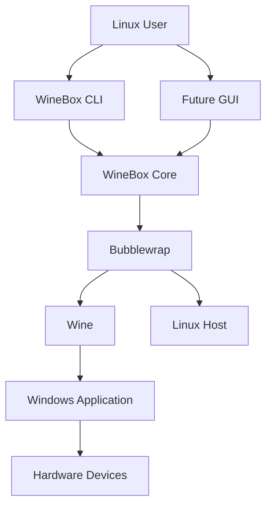
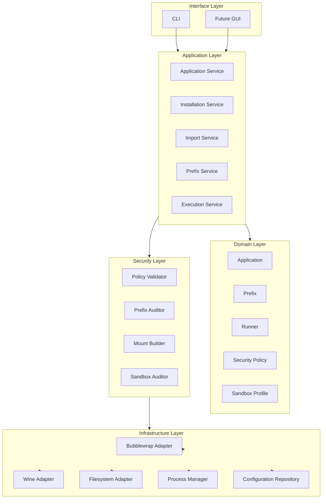
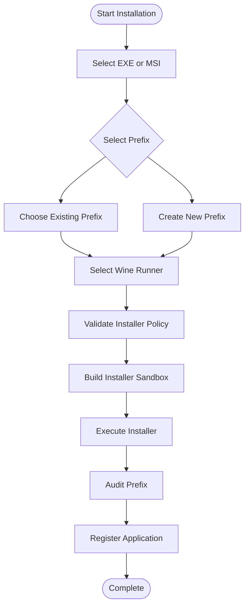
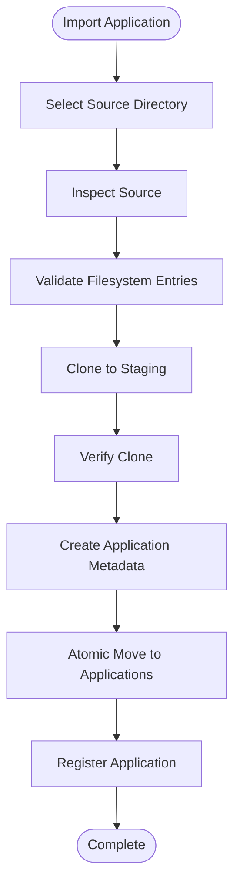
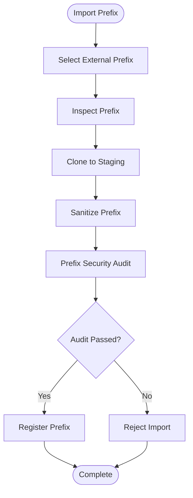
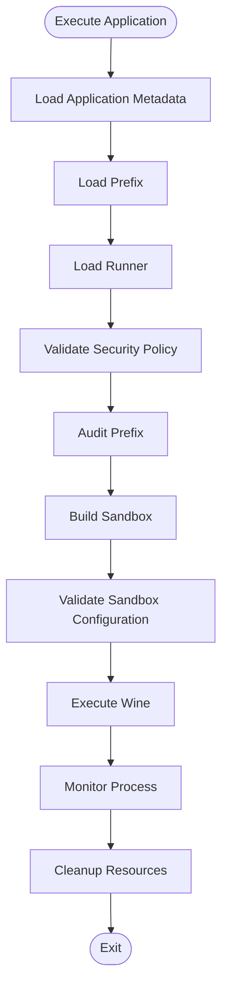

# WineBox
## Software Architecture Document (SAD)

**Document Version:** 1.0  
**Document Status:** Draft for Review  
**Project:** WineBox  
**Architecture Style:** Modular Layered Architecture  
**Primary Language:** Python  
**Initial Interface:** CLI  
**Sandbox Engine:** Bubblewrap (bwrap)  
**Windows Compatibility Layer:** Wine  

---

# 1. Introduction

## 1.1 Purpose

Dokumen ini menjelaskan arsitektur perangkat lunak WineBox, sebuah aplikasi untuk mengelola dan menjalankan aplikasi Windows di Linux melalui Wine dengan isolasi keamanan menggunakan Bubblewrap.

SAD ini menjadi referensi utama dalam proses pengembangan WineBox, meliputi:

- Struktur arsitektur perangkat lunak.
- Komponen utama dan tanggung jawabnya.
- Manajemen aplikasi dan Wine Prefix.
- Mekanisme instalasi dan import aplikasi.
- Pengelolaan Wine Runner.
- Arsitektur sandbox dan keamanan.
- Manajemen proses aplikasi.
- Struktur konfigurasi dan penyimpanan data.
- Strategi pengujian dan deployment.

Dokumen ini juga menjadi dasar untuk menyusun Architecture Decision Records (ADR), technical specifications, dan development documentation.

## 1.2 Background

Wine memungkinkan aplikasi Windows dijalankan di Linux tanpa memerlukan instalasi sistem operasi Windows secara penuh.

Namun, menjalankan aplikasi Windows secara langsung menggunakan Wine tidak memberikan isolasi filesystem dan akses sistem yang memadai untuk menghadapi aplikasi yang tidak tepercaya.

Bubblewrap menyediakan mekanisme sandbox berbasis Linux namespaces dan filesystem isolation.

WineBox menggabungkan kedua teknologi tersebut dalam satu sistem pengelolaan sehingga pengguna dapat menjalankan aplikasi Windows dengan konfigurasi keamanan yang terkontrol.

WineBox bukan pengganti Wine maupun Bubblewrap. WineBox bertindak sebagai orchestrator yang mengatur konfigurasi, lifecycle, dan kebijakan keamanan keduanya.

## 1.3 Vision

Membangun platform pengelolaan aplikasi Windows di Linux yang mengutamakan isolasi, keamanan, kemudahan pengelolaan, dan fleksibilitas konfigurasi.

Prinsip utama:

> Hardware Allowed, Host Filesystem Denied.

> Isolated by Default. Hardware Access by Policy.

> No Sandbox, No Execution.

## 1.4 Objectives

WineBox memiliki tujuan berikut:

1. Menjalankan aplikasi Windows melalui Wine di dalam sandbox.
2. Mengisolasi data aplikasi dari filesystem pribadi host.
3. Mengelola Wine Prefix secara terpusat.
4. Mendukung instalasi aplikasi melalui installer Windows.
5. Mendukung import aplikasi portable.
6. Mendukung import Wine Prefix eksternal.
7. Mendukung beberapa aplikasi dalam satu Wine Prefix.
8. Mengelola berbagai versi Wine Runner.
9. Mengatur akses hardware berdasarkan kebijakan keamanan.
10. Menyediakan CLI sebagai antarmuka utama.
11. Menyediakan fondasi untuk pengembangan GUI pada tahap berikutnya.
12. Menyediakan audit dan logging terhadap aktivitas aplikasi.

## 1.5 Non-Goals

WineBox tidak bertujuan untuk:

- Menggantikan Wine.
- Menggantikan Bubblewrap.
- Menjadi hypervisor atau virtual machine manager.
- Memberikan proteksi setara VM terhadap seluruh eksploitasi kernel.
- Menjadi antivirus atau malware analysis platform.
- Menjamin seluruh aplikasi Windows kompatibel dengan Linux.
- Menyediakan compatibility layer sendiri.
- Mengelola seluruh paket dan dependensi Linux host.
- Memberikan akses filesystem host tanpa batas.

---

# 2. Scope and Platform

## 2.1 Initial Platform Support

Target awal WineBox adalah distribusi Linux yang menyediakan:

- Linux kernel dengan dukungan namespaces yang dibutuhkan.
- Bubblewrap.
- Wine.
- Filesystem Linux yang mendukung permission dan operasi filesystem yang dibutuhkan.
- Python runtime.

Systemd menjadi target integrasi awal untuk pengelolaan layanan dan proses tambahan jika diperlukan.

Namun, WineBox Core sebaiknya tidak memiliki ketergantungan langsung yang tidak perlu terhadap systemd. Hal ini memungkinkan pengembangan dukungan distribusi lain pada masa mendatang.

## 2.2 Initial Dependencies

| Component | Responsibility |
|---|---|
| Python | Runtime WineBox |
| Bubblewrap | Sandbox isolation |
| Wine | Windows compatibility layer |
| Wine Server | Wine process coordination |
| systemd | Optional system integration |
| Filesystem | Prefix, application, configuration storage |
| TOML | Configuration format |
| pytest | Automated testing |

Versi minimum masing-masing dependency belum ditetapkan dan akan ditentukan melalui compatibility testing.

## 2.3 Initial Development Scope

Tahap pertama berfokus pada:

- CLI.
- Application Registry.
- Prefix Manager.
- Runner Manager.
- Sandbox Engine.
- Security Policy.
- Prefix Audit.
- Application Installation.
- Application Import.
- Prefix Import.
- Process Lifecycle Management.

GUI belum menjadi bagian dari MVP.

---

# 3. Architectural Principles

## 3.1 Security by Default

Semua aplikasi wajib dijalankan melalui sandbox.

WineBox tidak boleh menyediakan fallback untuk menjalankan aplikasi secara langsung di host ketika sandbox gagal dibuat.

## 3.2 Fail Closed

Jika komponen keamanan gagal, WineBox harus menolak eksekusi.

Contohnya:

- Bubblewrap tidak tersedia.
- Required namespace tidak dapat dibuat.
- Security policy tidak valid.
- Prefix gagal melewati audit.
- Mount configuration tidak valid.
- Sandbox runtime tidak memenuhi persyaratan.

## 3.3 Separation of Concerns

Setiap komponen memiliki tanggung jawab yang jelas.

Contohnya:

- Application Manager mengelola metadata aplikasi.
- Prefix Manager mengelola Wine Prefix.
- Runner Manager mengelola versi Wine.
- Security Manager memvalidasi kebijakan.
- Sandbox Engine membangun lingkungan isolasi.
- Process Manager mengelola lifecycle proses.

## 3.4 Single Sandbox Execution Path

Seluruh proses eksekusi Wine harus melewati Sandbox Engine.

Tidak boleh ada module lain yang menjalankan Wine secara langsung menggunakan `subprocess` tanpa melewati mekanisme keamanan WineBox.

## 3.5 Policy-Based Hardware Access

Akses hardware tidak diberikan secara otomatis.

Setiap akses harus ditentukan melalui security policy.

## 3.6 Source Immutability During Import

Import aplikasi dan prefix tidak boleh memodifikasi sumber aslinya.

WineBox menggunakan mekanisme cloning ke storage internal.

## 3.7 Shared Prefix Support

Beberapa aplikasi boleh menggunakan satu Wine Prefix.

Namun, aplikasi yang menggunakan prefix yang sama berbagi environment Windows, konfigurasi, registry, dan data dalam prefix tersebut.

## 3.8 Core Independence

CLI dan GUI merupakan antarmuka terhadap WineBox Core.

Business logic dan security enforcement tidak boleh diimplementasikan ulang secara terpisah pada masing-masing interface.

---

# 4. System Context

## 4.1 System Context Diagram



## 4.2 External Dependencies

WineBox berinteraksi dengan beberapa komponen eksternal:

| External Component | Purpose |
|---|---|
| Linux Kernel | Namespaces, process isolation, device access |
| Bubblewrap | Filesystem and namespace sandbox |
| Wine | Windows API compatibility |
| Wine Server | Wine process coordination |
| GPU Driver | Graphics acceleration |
| PipeWire | Audio integration |
| Display Server | GUI rendering |
| Linux Filesystem | Persistent application storage |

WineBox bertanggung jawab mengatur interaksi tersebut sesuai kebijakan keamanan.

---

# 5. High-Level Architecture

## 5.1 Architecture Overview

WineBox menggunakan Modular Layered Architecture.



## 5.2 Interface Layer

Bertanggung jawab menyediakan interaksi pengguna dengan WineBox.

Komponen:

- CLI.
- Future GUI.
- Future external integrations.

Interface hanya menangani input, output, validasi dasar, dan penyampaian hasil operasi.

Interface tidak boleh mengambil alih tanggung jawab security enforcement.

## 5.3 Application Layer

Application Layer mengimplementasikan use case WineBox.

Komponen utama:

- Application Service.
- Installation Service.
- Import Service.
- Execution Service.
- Prefix Service.
- Runner Service.
- Security Service.

Layer ini mengatur workflow antarkomponen dan memastikan operasi dilakukan dalam urutan yang benar.

## 5.4 Domain Layer

Domain Layer berisi model dan aturan bisnis inti.

Entitas utama:

- Application.
- Prefix.
- Runner.
- Security Policy.
- Sandbox Profile.
- Hardware Permission.

Domain tidak boleh bergantung langsung pada implementasi Bubblewrap, Wine, atau CLI.

## 5.5 Security Layer

Security Layer bertanggung jawab melakukan validasi dan enforcement keamanan.

Tanggung jawab:

- Validasi security policy.
- Audit Wine Prefix.
- Validasi filesystem mount.
- Validasi namespace.
- Penyusunan permission hardware.
- Validasi sandbox sebelum eksekusi.

Security Layer merupakan bagian wajib dari execution workflow.

## 5.6 Infrastructure Layer

Infrastructure Layer menyediakan implementasi teknis untuk berinteraksi dengan sistem operasi.

Tanggung jawab:

- Bubblewrap Adapter.
- Wine Adapter.
- Filesystem Adapter.
- Process Manager.
- Configuration Repository.
- Logging Adapter.

Infrastructure tidak boleh mengambil keputusan keamanan sendiri tanpa melalui Security Layer.

---

# 6. Core Components

## 6.1 Application Manager

Mengelola metadata aplikasi yang terdaftar di WineBox.

Tanggung jawab:

- Register application.
- Update application metadata.
- Remove application registration.
- Retrieve application details.
- List installed applications.
- Associate application with prefix.
- Associate application with runner.
- Store executable path.
- Store security profile.

Application Manager tidak bertanggung jawab mengelola Wine Prefix secara langsung.

## 6.2 Application Registry

Application Registry merupakan penyimpanan metadata aplikasi.

Contoh:

```toml
[application]
id = "fl-studio"
name = "FL Studio"
deployment_type = "installed"
status = "ready"

[prefix]
id = "creative"

[runner]
id = "wine-stable"

[executable]
path = "C:/Program Files/Image-Line/FL Studio 2026/FL64.exe"

[security]
profile = "creative"
```

Nilai `deployment_type` menjelaskan bagaimana aplikasi dideploy, bukan asal prefix atau status aplikasi.

Jenis deployment awal:

- `installed`
- `portable`

## 6.3 Installation Manager

Mengelola instalasi aplikasi Windows melalui installer.

Tanggung jawab:

- Menjalankan installer EXE atau MSI.
- Memilih Wine Prefix.
- Menggunakan Wine Runner.
- Mengatur installer security policy.
- Memantau proses instalasi.
- Menjalankan prefix audit setelah instalasi.
- Menyimpan metadata aplikasi setelah proses selesai.

## 6.4 Import Manager

Mengelola import aplikasi dan prefix eksternal.

Import Manager mempunyai dua workflow utama:

1. Application Import.
2. Prefix Import.

Keduanya menggunakan staging directory dan tidak boleh menjalankan aplikasi dari sumber eksternal secara langsung.

## 6.5 Prefix Manager

Mengelola seluruh lifecycle Wine Prefix.

Tanggung jawab:

- Create prefix.
- Initialize prefix.
- Import prefix.
- Clone prefix.
- Validate prefix.
- Sanitize prefix.
- Audit prefix.
- Backup dan restore.
- Prefix locking.
- Remove prefix.

## 6.6 Runner Manager

Mengelola Wine Runner.

Tanggung jawab:

- Register runner.
- Detect Wine version.
- Validate runner executable.
- Select runner for application.
- Support multiple runner versions.
- Store runner metadata.

Runner harus dikelola secara terpisah dari aplikasi dan prefix.

## 6.7 Security Manager

Security Manager merupakan pusat pengelolaan kebijakan keamanan.

Tanggung jawab:

- Load security profile.
- Validate policy.
- Resolve permission.
- Validate requested mounts.
- Enforce default-deny behavior.
- Coordinate prefix audit.
- Coordinate sandbox audit.

## 6.8 Sandbox Engine

Sandbox Engine bertanggung jawab membangun dan menjalankan sandbox menggunakan Bubblewrap.

Tanggung jawab:

- Namespace configuration.
- Filesystem mount configuration.
- Device access configuration.
- Environment variable configuration.
- Working directory configuration.
- Wine execution.
- Sandbox validation.

Sandbox Engine adalah satu-satunya jalur eksekusi Wine yang diperbolehkan.

## 6.9 Process Manager

Process Manager mengelola lifecycle proses yang dijalankan melalui Sandbox Engine.

Tanggung jawab:

- Start process.
- Track process.
- Capture exit code.
- Capture stdout dan stderr.
- Handle termination.
- Handle timeout jika didukung.
- Manage Wine Server lifecycle.
- Cleanup temporary resources.

---

# 7. Application Deployment Architecture

## 7.1 Deployment Types

WineBox mendukung tiga workflow deployment utama.

| Workflow | Description |
|---|---|
| Install Application | Instalasi aplikasi melalui EXE atau MSI |
| Import Application | Menyalin aplikasi portable atau direktori aplikasi |
| Import Prefix | Mengimpor Wine Prefix eksternal |

Selain itu, WineBox mendukung registrasi executable yang sudah tersedia di Wine Prefix internal.

## 7.2 Installation Workflow

Pengguna dapat memilih:

- Menggunakan Wine Prefix yang sudah ada.
- Membuat Wine Prefix baru melalui installation wizard.

Workflow:



Installer harus dijalankan di dalam sandbox.

Installer source hanya boleh diberikan sebagai mount read-only.

Prefix menjadi writable selama instalasi.

Installer policy dan runtime policy harus dipisahkan.

## 7.3 Installation Wizard

Installation wizard menyediakan alur konfigurasi instalasi.

Fitur:

- Installer selection.
- Prefix selection.
- Create new prefix.
- Runner selection.
- Installer permission configuration.
- Network permission configuration.
- Installation execution.
- Post-installation audit.
- Application registration.

Wizard tidak boleh melewati validasi keamanan.

## 7.4 Application Import Workflow

Application Import ditujukan untuk aplikasi portable atau aplikasi yang sudah diekstrak.

Source application tidak digunakan secara langsung saat runtime.

WineBox melakukan cloning ke internal storage.



Persyaratan:

- Source tidak dimodifikasi.
- Direktori disalin ke staging terlebih dahulu.
- Symlink harus diperiksa.
- Symlink yang mengarah ke luar source ditolak secara default.
- Special files ditolak secara default.
- Hard link diubah menjadi file independen.
- Struktur direktori dan regular files dipertahankan.
- Clone harus diverifikasi.
- Operasi gagal tidak boleh meninggalkan aplikasi dalam status `ready`.

Contoh metadata:

```toml
[application]
id = "portable-editor"
name = "Portable Editor"
deployment_type = "portable"
status = "ready"

[prefix]
id = "creative"

[executable]
path = "/winebox/applications/portable-editor/files/editor.exe"

[security]
profile = "default"
```

Direktori `files/` read-only saat runtime secara default.

Jika aplikasi membutuhkan data yang dapat ditulis, WineBox menyediakan direktori `data/` dengan permission eksplisit.

## 7.5 Prefix Import Workflow

Prefix Import memungkinkan pengguna mengimpor Wine Prefix eksternal.

Source prefix tidak pernah digunakan secara langsung.

Workflow:



Persyaratan:

- Source prefix tidak dimodifikasi.
- Cloning dilakukan ke staging.
- Symlink diperiksa.
- Drive mapping diperiksa.
- Junction dan reparse points diperiksa.
- Registry diperiksa jika memungkinkan.
- Wine `Z:` tidak boleh mengekspos host root.
- Prefix harus melewati sanitization dan audit.
- Prefix yang gagal audit tidak boleh digunakan.

WineBox dapat mencoba mendeteksi aplikasi dari executable dan registry.

Hasil deteksi harus dikonfirmasi pengguna sebelum aplikasi didaftarkan.

## 7.6 Application Registration

Application Registration memungkinkan pengguna mendaftarkan executable yang sudah ada dalam Wine Prefix internal tanpa melakukan instalasi ulang.

Registration hanya menyimpan metadata dan hubungan aplikasi dengan prefix.

Proses registrasi tidak boleh dianggap sebagai proses instalasi.

---

# 8. Prefix Management Architecture

## 8.1 Prefix Structure

Setiap prefix memiliki Linux HOME privat.

Contoh:

```text
Prefixes/
└── creative/
    ├── prefix/
    │   ├── drive_c/
    │   ├── dosdevices/
    │   ├── system.reg
    │   ├── user.reg
    │   └── userdef.reg
    ├── home/
    │   └── winebox/
    ├── config.toml
    └── logs/
```

Struktur aktual mengikuti kebutuhan Wine dan hasil pengujian implementasi.

## 8.2 Linux HOME Isolation

Linux HOME dan Windows user profile adalah dua hal berbeda.

WineBox harus mengatur keduanya secara terpisah:

- Linux `HOME` diarahkan ke direktori privat prefix.
- Wine Windows user profile berada di dalam prefix.
- Tidak ada shared HOME untuk seluruh prefix WineBox.

Contoh Windows user profile:

```text
drive_c/users/winebox/
├── Desktop/
├── Documents/
├── Downloads/
├── Music/
├── Pictures/
├── Videos/
└── AppData/
```

## 8.3 Prefix Origin

Prefix memiliki metadata asal:

- `created`
- `imported`

Origin berbeda dari application deployment type.

## 8.4 Prefix Status

Status prefix dapat mencakup:

- `staging`
- `ready`
- `failed`
- `disabled`

Prefix hanya boleh digunakan jika status dan hasil audit memenuhi persyaratan.

## 8.5 Prefix Locking

Prefix membutuhkan locking untuk mencegah operasi yang saling bertabrakan.

Operasi yang wajib menggunakan exclusive lock:

- Installation.
- Prefix import.
- Prefix modification.
- Backup.
- Restore.
- Sanitization.

Dukungan multiple concurrent runtime pada satu prefix belum diputuskan dan memerlukan pengujian khusus.

---

# 9. Runner Management Architecture

## 9.1 Runner Concept

Runner adalah instalasi Wine yang digunakan untuk menjalankan aplikasi.

Satu aplikasi dapat menggunakan runner yang berbeda tanpa harus membuat prefix baru.

Runner tidak boleh digabungkan dengan metadata aplikasi.

## 9.2 Runner Responsibilities

- Version detection.
- Executable validation.
- Runner registration.
- Runner selection.
- Runner compatibility check.

## 9.3 Runner Storage

Contoh struktur:

```text
Runners/
├── wine-stable/
│   ├── bin/
│   ├── lib/
│   └── runner.toml
└── wine-staging/
    ├── bin/
    ├── lib/
    └── runner.toml
```

Struktur tersebut merupakan gambaran konseptual. Implementasi dapat menggunakan system Wine atau Wine Runner yang dikelola secara internal.

---

# 10. Security Architecture

## 10.1 Security Model

WineBox menerapkan default-deny security model.

Semua permission harus didefinisikan secara eksplisit.

Security boundary utama berada pada kombinasi:

- Linux namespaces.
- Bubblewrap filesystem isolation.
- Mount restrictions.
- Device restrictions.
- Network policy.
- Prefix isolation.
- Process isolation.

## 10.2 Host Filesystem Protection

WineBox tidak boleh mengekspos seluruh host filesystem.

Area yang tidak boleh tersedia secara default:

- Host HOME.
- `/root`.
- `/media`.
- `/mnt`.
- SSH credentials.
- Browser profiles.
- Personal documents.
- Host D-Bus socket.
- Arbitrary host directories.

Wine tetap membutuhkan library, executable, dan runtime Linux.

Oleh karena itu, WineBox dapat menyediakan selected host runtime paths secara read-only.

Read-only mount bukan berarti seluruh path tersebut otomatis aman. Setiap path harus diperiksa dan dibatasi.

## 10.3 Wine Drive Mapping

Wine drive mapping harus diperiksa secara eksplisit.

Ketentuan:

- `C:` mengarah ke Wine Prefix.
- `Z:` tidak boleh mengekspos host root.
- Mapping drive lain harus berdasarkan policy.
- Symlink dan mapping yang dapat keluar dari sandbox harus diaudit.

## 10.4 Prefix Sanitization

Prefix Auditor harus memeriksa:

- Symlink.
- Drive mapping.
- Junction dan reparse points.
- Registry mapping.
- Unexpected host paths.
- Dangerous mount references.
- Invalid filesystem entries.

Prefix yang gagal audit tidak boleh dijalankan.

## 10.5 Installer Security

Installer dan runtime menggunakan security policy terpisah.

Installer tidak otomatis memperoleh permission lebih besar daripada runtime.

Installer source harus di-mount read-only.

Prefix dapat ditulis selama instalasi.

Network permission harus diberikan secara eksplisit.

## 10.6 Threat Model

| Threat | Mitigation |
|---|---|
| Aplikasi membaca dokumen host | Private HOME dan filesystem isolation |
| Aplikasi mengakses SSH credentials | Host HOME tidak diekspos |
| Aplikasi mengakses host root | Tidak ada unrestricted root mount |
| Prefix mengekspos host filesystem | Prefix sanitization dan audit |
| Installer mengakses source files | Read-only installer mount |
| Aplikasi mengakses perangkat tanpa izin | Device policy |
| Aplikasi mengakses jaringan tanpa izin | Network namespace policy |
| Wine child process keluar dari sandbox | PID namespace dan process supervision |
| Aplikasi mengakses host D-Bus | Host D-Bus tidak diekspos secara default |
| Sandbox gagal dibuat | Fail closed |

## 10.7 Security Limitations

Bubblewrap bukan virtual machine.

WineBox berbagi kernel host.

Oleh karena itu, sandbox tidak memberikan perlindungan absolut terhadap kernel vulnerabilities atau seluruh kemungkinan privilege escalation.

Untuk analisis malware berisiko tinggi, gunakan VM yang diperkeras dengan snapshot, tanpa shared folders atau clipboard, dan jaringan yang dinonaktifkan jika tidak diperlukan.

---

# 11. Sandbox Architecture

## 11.1 Sandbox Engine

Sandbox Engine merupakan komponen yang menyusun konfigurasi Bubblewrap.

Komponen internal:

- Namespace Manager.
- Mount Builder.
- Device Manager.
- Environment Builder.
- Sandbox Validator.
- Bubblewrap Adapter.

## 11.2 Namespace Requirements

Namespace yang direncanakan:

| Namespace | Requirement | Purpose |
|---|---|---|
| User | Required | User isolation |
| Mount | Required | Filesystem isolation |
| PID | Required | Process isolation |
| IPC | Required | IPC isolation |
| UTS | Required | Hostname isolation |
| Network | Configurable | Network isolation |

Jika namespace wajib tidak tersedia, WineBox harus menolak eksekusi.

## 11.3 Filesystem Mount Architecture

Mount dibangun berdasarkan prinsip minimum required access.

Mount dapat mencakup:

- Selected runtime libraries.
- Selected executable paths.
- Wine Runner.
- Wine Prefix.
- Prefix-private HOME.
- Application files.
- Application writable data.
- Required display socket.
- Required audio socket.
- Explicitly permitted device nodes.

Mount tidak boleh memberikan akses unrestricted ke host filesystem.

## 11.4 Device Access

Akses perangkat ditentukan melalui hardware permission policy.

| Device | Default | Permission Model |
|---|---|---|
| GPU | Denied | Selective device nodes |
| Audio | Denied | Selected PipeWire socket |
| MIDI | Denied | Explicit ALSA sequencer access |
| Gamepad | Denied | Selected input devices |
| USB | Denied | Explicit device allowlist |
| Display | Denied | Explicit display integration |

Implementasi GPU perlu memperhatikan perbedaan Intel/AMD dan NVIDIA.

`/dev/dri` dapat digunakan sebagai salah satu pendekatan untuk Intel/AMD. NVIDIA membutuhkan mekanisme tambahan yang harus divalidasi.

WineBox tidak boleh melakukan bind seluruh `/dev` secara otomatis.

## 11.5 Display Integration

Display integration harus dilakukan secara eksplisit.

Wayland menjadi target awal yang direkomendasikan.

X11 memiliki risiko tambahan karena akses terhadap X server dapat memberikan kemampuan mengamati atau berinteraksi dengan aplikasi lain.

Jika X11 didukung, nested X server dapat dievaluasi sebagai pendekatan isolasi tambahan.

## 11.6 Audio Integration

Audio dapat menggunakan PipeWire melalui socket yang dipilih.

Host D-Bus tidak boleh diekspos hanya demi menyediakan audio.

Akses PipeWire tetap dianggap sebagai permission terhadap service host dan harus diperhitungkan dalam security policy.

## 11.7 Network Policy

WineBox merencanakan tiga mode jaringan:

| Mode | Description |
|---|---|
| Disabled | Tidak memiliki akses jaringan |
| Shared | Menggunakan jaringan host sesuai konfigurasi namespace |
| Restricted | Akses jaringan dibatasi berdasarkan policy |

MVP berfokus pada Disabled dan Shared.

Restricted membutuhkan mekanisme enforcement tambahan, seperti firewall atau proxy.

Shared networking bukan berarti aplikasi hanya dapat mengakses internet. Aplikasi juga berpotensi mengakses service lokal atau perangkat LAN.

---

# 12. Process Lifecycle Management

## 12.1 Execution Lifecycle



## 12.2 Process Isolation

Seluruh Wine process harus berada dalam sandbox.

Hal ini mencakup:

- Wine executable.
- Wine Server.
- Windows application process.
- Helper processes.

WineBox harus memastikan child process tidak dapat keluar dari sandbox.

PID namespace dan lifecycle Wine Server harus diuji secara khusus.

## 12.3 Process Supervision

Process Manager bertanggung jawab:

- Memantau proses utama.
- Memantau child process.
- Menangani termination.
- Mencatat exit code.
- Membersihkan resource sementara.
- Memastikan proses Wine tidak tertinggal di luar lifecycle sandbox.

Detail implementasi supervision akan ditetapkan pada technical specification.

---

# 13. Data and Configuration Architecture

## 13.1 Storage Architecture

WineBox menggunakan penyimpanan terpisah berdasarkan tanggung jawab.

Contoh struktur konseptual:

```text
WineBox/
├── Applications/
│   ├── fl-studio/
│   │   ├── application.toml
│   │   ├── files/
│   │   └── data/
│   └── portable-editor/
│       ├── application.toml
│       ├── files/
│       └── data/
│
├── Prefixes/
│   ├── creative/
│   │   ├── prefix/
│   │   ├── home/
│   │   ├── config.toml
│   │   └── logs/
│   └── gaming/
│       ├── prefix/
│       ├── home/
│       ├── config.toml
│       └── logs/
│
├── Runners/
│   ├── wine-stable/
│   └── wine-staging/
│
└── Staging/
    ├── application-imports/
    └── prefix-imports/
```

Struktur tersebut adalah logical storage model.

Lokasi aktual harus mengikuti XDG Base Directory Specification dan mempertimbangkan user installation versus system installation.

## 13.2 Data Separation

Data dibedakan menjadi:

| Data | Responsibility |
|---|---|
| Application Metadata | Informasi dan konfigurasi aplikasi |
| Prefix Data | Wine environment |
| Prefix HOME | Linux user environment privat |
| Runner Data | Wine executable dan dependencies |
| Application Files | File aplikasi portable |
| Application Data | Data writable aplikasi |
| Staging Data | Import dan deployment sementara |
| Logs | Aktivitas dan audit |

## 13.3 Metadata Separation

WineBox harus membedakan tiga jenis metadata:

**Deployment Type**

- `installed`
- `portable`

**Prefix Origin**

- `created`
- `imported`

**Status**

- `staging`
- `ready`
- `failed`
- `disabled`

Ketiganya tidak boleh digabungkan menjadi satu field.

## 13.4 Configuration Format

TOML digunakan sebagai format konfigurasi awal.

Contoh prefix configuration:

```toml
[prefix]
id = "creative"
name = "Creative Environment"
origin = "created"
status = "ready"

[runner]
id = "wine-stable"

[security]
profile = "creative"

[environment]
home_isolated = true
```

Contoh security profile:

```toml
[profile]
id = "creative"
name = "Creative Applications"

[filesystem]
host_home = false
host_root = false
read_only_runtime = true

[network]
mode = "disabled"

[hardware]
gpu = true
audio = true
midi = false
gamepad = false
usb = false
```

Konfigurasi di atas merupakan contoh konseptual. Validasi dan resolusi permission harus dilakukan oleh Security Manager, bukan hanya mengandalkan nilai konfigurasi.

---

# 14. CLI Architecture

## 14.1 CLI-First Approach

CLI menjadi interface utama pada MVP.

CLI harus berinteraksi dengan Application Layer melalui use case service.

CLI tidak boleh memanggil Wine atau Bubblewrap secara langsung.

## 14.2 Proposed CLI Commands

```text
winebox
├── app
│   ├── list
│   ├── info
│   ├── register
│   ├── remove
│   └── run
│
├── install
│
├── import
│   ├── app
│   └── prefix
│
├── prefix
│   ├── list
│   ├── create
│   ├── info
│   ├── audit
│   ├── backup
│   ├── restore
│   └── remove
│
├── runner
│   ├── list
│   ├── register
│   └── info
│
├── security
│   ├── profile
│   ├── audit
│   └── permissions
│
└── system
    ├── doctor
    └── version
```

Daftar command ini merupakan rancangan awal dan dapat berubah setelah CLI Specification dibuat.

## 14.3 CLI Responsibilities

CLI bertanggung jawab:

- Parsing arguments.
- Menampilkan informasi.
- Meminta konfirmasi pengguna.
- Memanggil application services.
- Menampilkan hasil operasi.
- Menyampaikan error secara konsisten.

---

# 15. Logging and Auditing

## 15.1 Logging

WineBox menyediakan logging untuk:

- Application lifecycle.
- Installation.
- Import.
- Prefix operations.
- Runner operations.
- Sandbox creation.
- Process execution.
- Security validation.
- Process termination.

## 15.2 Security Audit

Audit harus mencatat:

- Prefix audit result.
- Detected symlinks.
- Invalid drive mappings.
- Policy validation failures.
- Sandbox configuration failures.
- Permission granted.
- Permission denied.

## 15.3 Audit Integrity

Log harus disimpan di area WineBox yang tidak dapat ditulis langsung oleh aplikasi Windows.

Jangan menyimpan informasi rahasia seperti credential, token, atau isi file pribadi ke dalam log.

---

# 16. Error Handling

WineBox harus memiliki error classification yang konsisten.

Kategori awal:

| Category | Example |
|---|---|
| Dependency Error | Bubblewrap tidak tersedia |
| Platform Error | Namespace tidak didukung |
| Configuration Error | Security policy invalid |
| Prefix Error | Prefix gagal audit |
| Runner Error | Wine executable tidak valid |
| Sandbox Error | Mount gagal dibuat |
| Installation Error | Installer gagal |
| Import Error | Source tidak valid |
| Process Error | Proses gagal dijalankan |

Security-related errors harus menghasilkan penolakan eksekusi.

WineBox tidak boleh menurunkan tingkat keamanan secara otomatis untuk mengatasi error.

---

# 17. Testing Strategy

## 17.1 Unit Testing

Unit test mencakup:

- Domain models.
- Configuration parsing.
- Security policy validation.
- Metadata validation.
- Prefix path validation.
- Application registry.
- Runner validation.

## 17.2 Integration Testing

Integration test mencakup:

- Wine detection.
- Bubblewrap detection.
- Prefix creation.
- Prefix audit.
- Runner execution.
- Sandbox construction.
- Process supervision.

## 17.3 Security Testing

Security testing mencakup:

- Host HOME visibility.
- Host root visibility.
- `/media` dan `/mnt` visibility.
- SSH credential visibility.
- Browser profile visibility.
- Wine drive mapping.
- Symlink escape.
- Prefix import sanitization.
- Device access restriction.
- Network isolation.
- D-Bus isolation.
- Process escape attempts.

## 17.4 Import Testing

Import testing mencakup:

- Source immutability.
- Symlink handling.
- Hard link handling.
- Special file rejection.
- Staging cleanup.
- Interrupted import.
- Clone integrity.
- Atomic registration.

## 17.5 Regression Testing

Setiap perubahan pada sandbox, prefix, atau security policy harus menjalankan regression test untuk memastikan tidak terjadi penurunan keamanan.

---

# 18. Deployment Architecture

## 18.1 Initial Distribution

WineBox didistribusikan sebagai Python package terlebih dahulu.

Tahap selanjutnya adalah menyediakan paket `.deb`.

## 18.2 Installation Modes

Dua model instalasi perlu dipertimbangkan:

- User-level installation.
- System-level installation.

Data aplikasi, prefix, dan konfigurasi pengguna harus tetap memiliki batas ownership dan permission yang jelas.

## 18.3 XDG Directory Integration

WineBox sebaiknya mengikuti XDG Base Directory Specification untuk memisahkan:

- Executable dan package files.
- Configuration.
- Persistent application data.
- Runtime state.
- Cache.
- Logs.

Lokasi final masing-masing direktori akan ditentukan pada Configuration Specification.

---

# 19. Future Development

## 19.1 GUI

GUI akan dikembangkan setelah CLI dan Core stabil.

GUI harus menggunakan Application Layer yang sama dengan CLI.

## 19.2 Advanced Security

Fitur yang dapat dievaluasi:

- Restricted network.
- Advanced mount policy.
- Per-application hardware permissions.
- Resource limits.
- Additional syscall restrictions.
- Enhanced audit reporting.

Fitur tersebut tidak boleh dianggap tersedia sebelum implementasi dan pengujian selesai.

## 19.3 Application Profiles

WineBox dapat menyediakan security profile berdasarkan kebutuhan aplikasi, misalnya:

- General.
- Gaming.
- Creative.
- Office.
- Offline.

Nama profile tidak boleh menjadi pengganti validasi permission. Setiap profile tetap harus menghasilkan policy eksplisit yang dapat diaudit.

## 19.4 Application Integration

Integrasi desktop dapat dikembangkan untuk:

- Desktop entries.
- Application launcher.
- MIME association.
- File association.
- Application icons.

Integrasi tersebut tetap harus menjalankan aplikasi melalui WineBox Core.

---

# 20. Accepted Architectural Decisions

Keputusan berikut telah disepakati dalam diskusi desain WineBox.

| ID | Decision | Status |
|---|---|---|
| ADR-001 | Initial target: Linux with systemd and Bubblewrap | Accepted |
| ADR-002 | CLI-first, GUI later | Accepted |
| ADR-003 | Multiple applications may share one prefix | Accepted |
| ADR-004 | All applications must run sandboxed | Accepted |
| ADR-005 | Python package first, `.deb` later | Accepted |
| ADR-006 | HOME isolation per prefix | Accepted |
| ADR-007 | Installation wizard supports existing and new prefix | Accepted |
| ADR-008 | Portable application deployment uses copy into WineBox storage | Accepted |
| ADR-009 | External application directories are cloned into WineBox storage | Accepted |
| ADR-010 | External Wine Prefix import uses clone, sanitize, and audit | Accepted |
| ADR-011 | Wine runner strategy: System Wine default with custom path support | Accepted |
| ADR-012 | Bubblewrap namespace isolation (--unshare-all) and fail-fast validation | Accepted |
| ADR-013 | Desktop hardware integration: X11, audio, and GPU passthrough | Accepted |
| ADR-014 | Binary network policy model (disabled / enabled) | Accepted |
| ADR-015 | Storage layout based on XDG Base Directory Specification (rootless) | Accepted |
| ADR-016 | Single-instance prefix execution via file lock (prefix.lock) | Accepted |
| ADR-017 | Permissive hardware default policy (Hardware Allowed, Host Filesystem Denied) | Accepted |
| ADR-018 | CLI stack using Typer and Rich with system doctor diagnosis | Accepted |
| ADR-019 | Build and packaging tooling using PEP 621 with Hatchling | Accepted |

Catatan: Dokumen ADR individual lengkap terdokumentasi di direktori `docs/03-decisions/adr/`.

---

# 21. Open Technical Questions

Hal-hal berikut masih membutuhkan validasi dan keputusan teknis.

## 21.1 Bubblewrap and Namespace

- Minimum kernel version yang akan didukung.
- Ketersediaan user namespace pada berbagai distribusi.
- Required namespace combination.
- Mekanisme validasi namespace.
- Mount strategy lintas distribusi.

## 21.2 Wine Runtime

- Pengelolaan system Wine versus managed Wine Runner.
- Dependency discovery untuk Wine.
- Wine Server lifecycle.
- Multiple applications sharing one prefix secara bersamaan.
- Runner compatibility terhadap prefix.

## 21.3 Hardware

- Strategi NVIDIA GPU access.
- Wayland integration.
- X11 isolation.
- PipeWire socket access.
- MIDI dan ALSA integration.
- USB permission management.

## 21.4 Network

- Implementasi Restricted networking.
- Firewall integration.
- Proxy-based network filtering.
- LAN isolation.

## 21.5 Storage

- Final XDG directory mapping.
- User installation versus system installation.
- Backup format.
- Prefix migration.
- Storage quota dan disk-space validation.

## 21.6 Security

- Strategi menghadapi filesystem race conditions saat import.
- Reparse point dan junction handling.
- Hardening process supervision.
- Sandbox runtime verification.
- Audit log integrity.
- Batas keamanan terhadap aplikasi berbahaya.

Pertanyaan tersebut harus diselesaikan pada technical specifications dan ADR terkait sebelum fitur yang bergantung padanya dinyatakan production-ready.

---

# 22. Conclusion

WineBox dirancang sebagai sandbox orchestration manager untuk menjalankan aplikasi Windows di Linux menggunakan Wine dan Bubblewrap.

Arsitektur menggunakan Modular Layered Architecture dengan pemisahan tanggung jawab antara interface, application services, domain, security, dan infrastructure.

Seluruh proses instalasi dan eksekusi harus melewati mekanisme sandbox.

Pengelolaan aplikasi, prefix, runner, dan security policy dibuat terpisah agar sistem mudah dikembangkan dan dipelihara.

Prinsip utama WineBox tetap:

> No Sandbox, No Execution.

SAD ini menjadi dasar untuk penyusunan ADR, technical specifications, dan implementasi MVP WineBox.