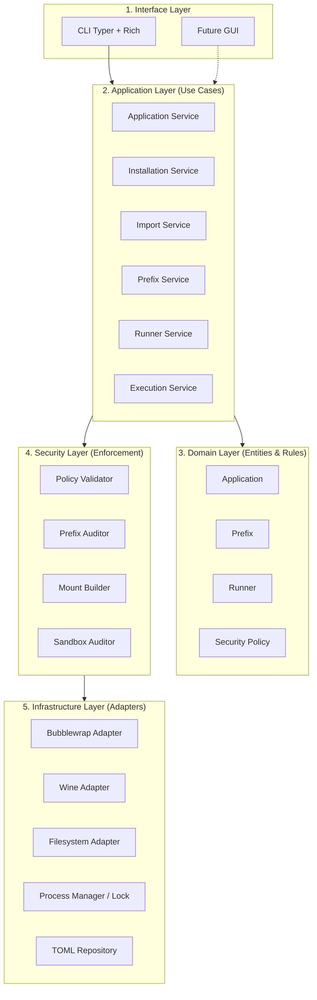

# Software Architecture

Dokumen ini menguraikan arsitektur tingkat tinggi WineBox berdasarkan [SAD.md](../../SAD.md).

## 1. Gaya Arsitektur

WineBox mengadopsi **Modular Layered Architecture** dengan batas tanggung jawab yang tegas antar-lapisan:

---

## 2. Rincian Layer

### 2.1 Interface Layer
- **Tanggung Jawab:** Menangani input argumen, interaksi wizard CLI, format tampilan pesan, dan diagnosa sistem.
- **Batasan:** Tidak boleh mengeksekusi subprocess `bwrap` atau `wine` secara langsung; wajib mendelegasikan ke Application Services.

### 2.2 Application Layer
- **Tanggung Jawab:** Mengorkestrasi alur kerja (use cases):
  - Registrasi & eksekusi aplikasi (`AppService`, `ExecutionService`).
  - Wizard instalasi file installer (`InstallService`).
  - Import aplikasi portable & prefix eksternal (`ImportService`).
  - Lifecycle prefix (`PrefixService`).
  - Registrasi runner (`RunnerService`).

### 2.3 Domain Layer
- **Tanggung Jawab:** Mendefinisikan struktur data inti dan invariant bisnis:
  - `Application`, `Prefix`, `Runner`, `SecurityPolicy`, `HostMount`.
  - Aturan validasi status (`staging`, `ready`, `failed`).
- Bebas dari dependensi framework eksternal atau I/O langsung.

### 2.4 Security Layer
- **Tanggung Jawab:** Penegakan batas keamanan:
  - `PolicyValidator`: Memvalidasi kepatuhan mount terhadap kebijakan keamanan host.
  - `PrefixAuditor`: Memindai symlink berbahaya, junction points, dan pemetaan drive Wine (`Z:` drive).
  - `MountBuilder`: Menghasilkan daftar argumen `--ro-bind`, `--bind`, `--dev-bind` untuk Bubblewrap secara deterministik.
  - `SandboxAuditor`: Memvalidasi integritas container sebelum dieksekusi.

### 2.5 Infrastructure Layer
- **Tanggung Jawab:** Komunikasi teknis dengan sistem operasi:
  - `BwrapAdapter`: Membangun dan menjalankan perintah CLI `bwrap`.
  - `WineAdapter`: Menangani argumen Wine, path runtime, dan `wineserver`.
  - `FilesystemAdapter`: Operasi file atomik, staging clone, dan scanning symlink.
  - `ProcessManager`: Penguncian `prefix.lock` via `fcntl.flock`, monitoring PID namespace.
  - `ConfigRepository`: Serialisasi dan deserialisasi file konfigurasi TOML.
