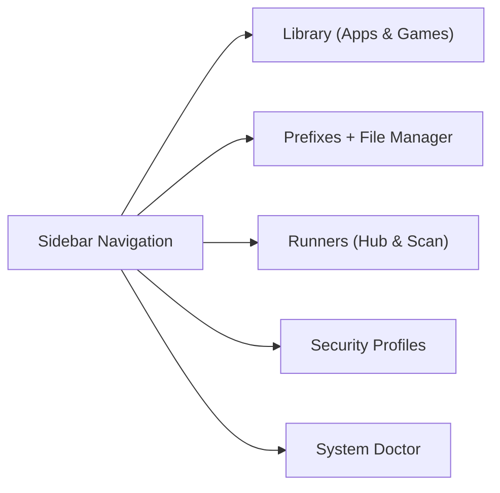

# WineBox GUI Launcher — Wireframe & Architecture Specification

Dokumen ini merangkum rancangan antarmuka grafis (*GUI Launcher*), perbandingan stack client, serta pemetaan fitur GUI ke service layer WineBox yang sudah ada (`src/winebox/application/`).

---

## 1. Perbandingan Tech Stack GUI Client

Seluruh logika bisnis WineBox (`AppService`, `PrefixService`, `RunnerService`, `ProfileService`, `ExecutionService`, `WinetricksService`, `DesktopService`) sudah terisolasi di layer Python `application/` dan SQLite (`winebox.db`), sehingga GUI tinggal menjadi layer `interface/` tambahan di samping CLI.

| Stack | Kelebihan | Kekurangan | Cocok Untuk |
|---|---|---|---|
| **PySide6 (Qt6)** | Pure `pip install PySide6` di `.venv`; `QThread` sangat matang untuk download progress & streaming log; langsung import `winebox.application.*`. | Ukuran dependency ~150 MB; tampilan Qt (bukan native GNOME Adwaita). | Development cepat, cross-DE (KDE, GNOME, XFCE, Hyprland). |
| **GTK4 + Libadwaita (`PyGObject`)** | Native GNOME/Wayland (gaya Bottles/Lutris), ringan (~30–50 MB RAM), langsung import `winebox.application.*`. | Butuh system package (`python3-gi`, `gir1.2-gtk-4.0`, `gir1.2-adw-1`). | Distribusi paket Linux native (`.deb`, Flatpak, AUR). |
| **Tauri / Web UI + CLI Bridge** | Desain custom penuh ala Steam/Heroic (React/Svelte/Tailwind). | Perlu IPC/JSON bridge ke CLI atau local daemon. | Fokus visual kustom tingkat tinggi. |

---

## 2. Peta Navigasi Utama



---

## 3. Wireframe Per Halaman

### A. Halaman `Library` (Default Home)
```text
+----------------------------------------------------------------------------------+
| WineBox   | [ Search apps...                ]   [ + Add App / Installer ]        |
+-----------+----------------------------------------------------------------------+
| Library   |  +----------------------------+  +----------------------------+      |
| Prefixes  |  | [Icon] Cyberpunk 2077      |  | [Icon] Notepad++           |      |
| Runners   |  | Prefix: gaming-pfx         |  | Prefix: utils-pfx          |      |
| Profiles  |  | Runner: ge-proton11-12     |  | Runner: wine-builds-11-22  |      |
| Doctor    |  | Policy: Disp Aud GPU Pad   |  | Policy: Disp               |      |
|           |  | [ ▶ Play ] [Logs] [⚙]     |  | [ ▶ Play ] [Logs] [⚙]     |      |
|           |  +----------------------------+  +----------------------------+      |
+-----------+----------------------------------------------------------------------+
```
- **+ Add App / Installer:** Membuka wizard pemilihan folder portable atau `.exe`/`.msi`, pemilihan/pembuatan Prefix, Security Profile, serta opsi ekspor `.desktop` / Lutris.
- **App Settings (`⚙`):** Mengedit argumen, environment variables, host mounts (`ro`/`rw`), runner, security profile, dan integrasi `.desktop`.
- **Running State:** Tombol `▶ Play` berubah menjadi `■ Kill` saat prefix aplikasi aktif.

---

### B. Halaman `Prefixes` + Embedded File Manager
```text
+----------------------------------------------------------------------------------+
| Prefixes  | Prefix: [ gaming-pfx ▼ ]   Status: ● Idle                            |
|           | [Winecfg] [Regedit] [CMD] [Winetricks] [Audit] [Backup] [Restore]    |
|           | [ ■ Kill ]                                                           |
+-----------+----------------------------------------------------------------------+
|           | Prefix File Manager                                                  |
|           | Tabs: [ drive_c/ ] [ home/ (Saves) ] [ logs/ ]   [Open in Host FM]   |
|           | Path: drive_c / Program Files / MyGame          [ + Import Mod/File ] |
|           +----------------------------------------------------------------------+
|           | Name                     | Type     | Size     | Actions             |
|           |--------------------------|----------|----------|---------------------|
|           | ..                       | Dir      | -        |                     |
|           | Data/                    | Dir      | -        | [Delete]            |
|           | MyGame.exe               | Binary   | 42.1 MB  | [Run] [Register]    |
|           | d3d9.dll                 | File     | 1.2 MB   | [Delete]            |
+-----------+----------------------------------------------------------------------+
```
- **Quick Wine Tools:** Menjalankan `winecfg`, `regedit`, `cmd`, `taskmgr` terisolasi di Bubblewrap (`PrefixRuntimeService.run_tool`).
- **Backup & Restore:** Ekspor snapshot `.tar.zst` (`PrefixBackupService.backup_prefix`) atau restore dari daftar backup yang tersedia.
- **Prefix File Manager (Aman):**
  - Menelusuri `prefix/drive_c`, `home/` (savegame & AppData), dan `logs/`.
  - **Symlink Guard:** Tidak menelusuri symlink keluar dari direktori prefix (misal entri di `dosdevices/` hanya ditampilkan sebagai badge `[Symlink]`).
  - **Quick Actions:** Klik kanan / tombol pada `.exe` untuk langsung **Run in Sandbox** atau **Register as App**, tombol **Import Mod/File**, dan tombol **Open in Host FM** (`xdg-open`) untuk operasi drag-and-drop desktop.

---

### C. Halaman `Runners`
```text
+----------------------------------------------------------------------------------+
| Runners   | [ Installed Runners ]  [ Install from Hub ]     [ Scan Steam/Lutris ]|
+-----------+----------------------------------------------------------------------+
|           | ID                  | Type   | Binary Path               | Shared    |
|           |---------------------|--------|---------------------------|-----------|
|           | system-wine         | System | /usr/bin/wine             | -         |
|           | proton-experimental | Custom | ~/.steam/.../files/bin/.. | External  |
|           | ge-proton11-12      | Custom | ~/.local/.../ge-proton..  | [ON]      |
|           | wine-builds-11-22   | Custom | ~/.local/.../wine-builds..| [ON]      |
+-----------+----------------------------------------------------------------------+
```
- **Install from Hub:** Pilih source (`wine-builds` / `ge-proton`), pilih versi (otomatis filter arsitektur host `x86_64`/`aarch64`), centang `Share to Lutris/Steam`, lalu tampilkan progress bar unduhan & ekstraksi.

---

### D. Halaman `Security Profiles` & `System Doctor`
- **Security Profiles:** Tabel & editor toggle switch untuk `Display`, `Audio`, `Network`, `GPU (/dev/dri)`, dan `Gamepad (/dev/input)`.
- **System Doctor:** Kartu status kesiapan host (`bwrap`, `userns`, `wine`, `X11/Wayland`, `Pulse/PipeWire`, `DRI GPU`).

---

## 4. Pemetaan ke Service Layer WineBox

| Aksi GUI | Service & Method WineBox |
|---|---|
| Daftar / Launch / Kill App | `AppService`, `ExecutionService.run_app`, `AppService.kill_app` |
| Buat / Audit / Hapus Prefix | `PrefixLifecycleService` (`create_prefix`, `audit_prefix`, `remove_prefix`) |
| Winecfg / Regedit / CMD / Kill Prefix | `PrefixRuntimeService` (`run_tool`, `kill_prefix`) |
| Backup & Restore Prefix | `PrefixBackupService` (`backup_prefix`, `restore_prefix`, `list_backups`) |
| Winetricks Installer | `WinetricksService.run_winetricks` |
| Install / Scan / Share Runner | `RunnerService` (`fetch_available_releases`, `install_runner`, `scan_external_runners`, `share_runner`) |
| Kelola Security Profile | `ProfileService` (`list_profiles`, `create_profile`, `update_profile`, `delete_profile`) |
| Cek Kesiapan Host | `DoctorAdapter` / `BwrapAdapter` |
