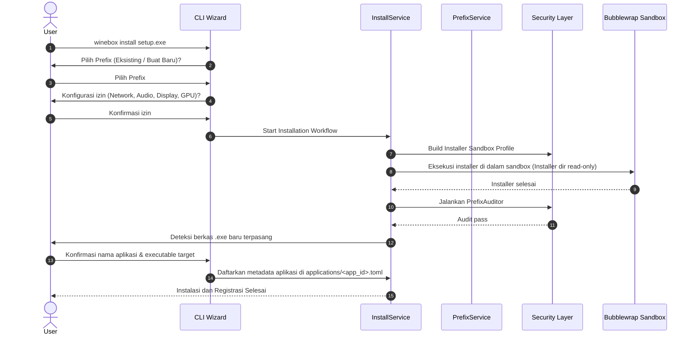

# Application Deployment Specification

Dokumen ini mendefinisikan alur teknis instalasi, import, dan registrasi aplikasi di WineBox.

## 1. Tiga Alur Deployment

| Jenis Deployment | Deskripsi | Target Storage |
|---|---|---|
| **Installer (.exe / .msi)** | Menjalankan installer Windows melalui sandbox ke dalam prefix. | `prefixes/<id>/prefix/drive_c/Program Files/...` |
| **Portable Application** | Menyalin direktori aplikasi biner mandiri langsung ke prefix. | `prefixes/<id>/prefix/drive_c/Program Files/<app_id>/` |
| **Import Prefix** | Mengkloning Wine Prefix eksternal ke storage WineBox. | `prefixes/<id>/prefix/` |

---

## 2. Alur Wizard Instalasi (`winebox install <file.exe>`)

---

## 3. Alur Import Aplikasi Portable (`winebox import app <dir>`)

1. Validasi input: Cek ketersediaan file executable utama di dalam direktori sumber.
2. Salin ke Staging: Salin isi direktori ke `staging/<temp_id>/`.
3. Audit Symlink: Pindai seluruh symlink. Pastikan tidak ada link yang merujuk keluar dari staging.
4. Pindahkan ke Prefix Target: Pindahkan direktori secara atomik ke:
   `prefixes/<prefix_id>/prefix/drive_c/Program Files/<app_id>/`.
5. Registrasi: Buat file metadata aplikasi di `applications/<app_id>.toml`.

---

## 4. Alur Import External Prefix (`winebox import prefix <dir>`)

1. Validasi input: Cek keberadaan file inti prefix (`system.reg`, `user.reg`, `drive_c`).
2. Salin ke Staging: Salin seluruh direktori ke `staging/prefix_<temp_id>/`.
3. Sanitasi Prefix:
   - Hapus pemetaan symlink `dosdevices/z:` yang menunjuk ke root host `/`.
   - Bersihkan entri symlink mencurigakan di dalam `drive_c`.
4. Prefix Audit: Jalankan `PrefixAuditor` untuk memverifikasi kepatuhan keamanan.
5. Pindahkan secara atomik ke `prefixes/<prefix_id>/prefix/`.
6. Inisialisasi struktur WineBox: Buat direktori pendukung (`home/`, `logs/`, `config.toml`).
